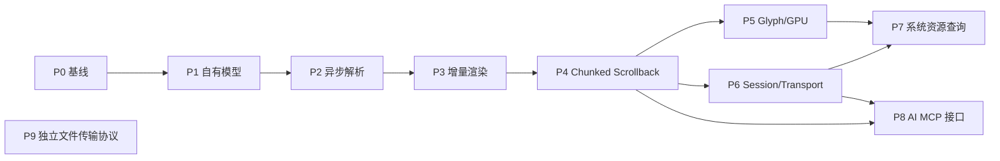

# NovaTerm 分阶段开发路线图

2026-10-27：新增 `novaterm_close_target`，当前二十一工具；仅关闭原操作创建且未人工接管、具有空闲证据的连接，保留终端。单文件传输和B4待后续，见[安全关闭记录](stages/P8_AI_MCP_Interface/records/B3b_Target_Close_2026-10-27.md)。

## 1. 依赖关系

阶段编号表示默认落地顺序，不禁止无侵入的前期调研。任何阶段不得绕过前一阶段确立的数据所有权。
P8 首期依赖 P4/P6 的有界文本与 Session 边界；受限 SSH 命令还需复用现有 exec
通道，并与 P7 静态预取/慢查询仲裁，不恢复后台文件系统轮询。

P9 的协议库与测试独立于 P6/P8，先按 XMODEM → YMODEM → ZMODEM 实现。
三个协议验收后再考虑依赖 P6 的串口接线；该接入不属于当前 P9 实施范围。

## 2. 状态与重点

| 阶段 | 状态 | 开发重点 | 关键退出条件 |
| --- | --- | --- | --- |
| P0 | 已完成（2026-07-29） | 测试、独立 Core、性能基线 | 基准可重复、Core 独立构建 |
| P1 | 退出标准已达成（2026-07-29 架构边界落地）；已完成增量：宽字符 continuation 回归（2026-09-03）、chunk 快照碎片化成本优化（尾部增量窄接口，2026-09-08）；剩余两个不阻塞边角项——活动屏幕不参与搜索、`dim`/`protectedCell` 因 vendored libvterm screen 层无来源 | Cell/ScreenBuffer/VTAdapter | Renderer 无 `VTerm*` |
| P2 | 功能与 20 MiB/s 性能目标完成（2026-08-01） | Worker、队列、背压、生命周期 | UI 不解析、无死锁/丢数据 |
| P3 | 实现与 Vulkan/OpenGL 实机 60 FPS 跑分完成（2026-08-01）；待高刷新率、资源恢复与人工视觉验收 | 调度、脏行、局部上传 | 单 Cell 不全屏扫描，60 FPS 实测 |
| P4 | 原 P4 已完成（2026-08-01）；LZ4 可选增量已接入，性能/长稳验收未完成，默认关闭（2026-10-19） | Chunk、快照、reflow、搜索 | 百万行内存受控，搜索不阻塞 |
| P5 | 实施完成；Linux Vulkan/OpenGL、Windows D3D11/D3D12 与 30 分钟长稳验收完成（2026-08-02）；macOS Metal、多屏 DPR 与 120/144 Hz 验收待完成 | 多页 Atlas、fallback、instancing | CJK/Emoji/DPI 正确且上传增量化 |
| P6 | 进行中：Transport 四种完成，会话编排采用「1 View 拥有 1 Session」已在生产；剩少量自包含项 | Session（View-owned）、SSH/Serial/Telnet | 每 View 一会话、完整生命周期 |
| P7 | 已实现为内置功能（常驻监控 2026-09-06、系统信息窗口 2026-09-09）；性能量化验收待补 | SSH 远端资源监控面板、系统信息窗口 | 复用单连接、快慢通道隔离、不反压 Parser |
| P8 | B0/B1、B2、B3/B3a已实施；2026-10-27 B3b提供显式共享的保存SSH/UART目标目录及独立授权的打开/复用/查询和安全关闭（当前二十一工具），未发布诊断/本机Agent原型保持退役；单文件传输、新会话预授权规则及真机/性能仍待后续 | SSH/UART观察、输入、缓存游标、可选清空、有界文本等待、长任务及独立保存目标目录；外部Agent编排BSP闭环 | 源码/替身、真实板卡双通道、客户端和性能分别验收，见 [实施顺序](stages/P8_AI_MCP_Interface/01_Phases_and_Acceptance.md) |
| P9 | 协议库及串口 Session/手动传输窗口已接入；Linux 纯协议、门面、UI 与真实 QSerialPort/raw PTY 通路测试通过；Windows 取消发布竞争用例有已知失败，macOS 与真实 UART 文件传输验收待补 | 独立协议库、Session 输入分流/输出独占、异步文件门面与手动串口窗口 | 三协议双向测试与互通、单通路接线及有界停止；跨平台/真实 UART 文件验收明确收口 |

**P9：文件传输协议**的范围、步骤和验收见
[P9 阶段文档](stages/P9_File_Transfer_Protocols.md)。

**P8：AI MCP 接口**采用 Session 只读上下文与独立授权的输入/命令能力。
[MCP当前接口契约](stages/P8_AI_MCP_Interface/02_Current_MCP_Contract.md)说明九终端工具与三历史工具的兼容基线；[实施与验收记录](stages/P8_AI_MCP_Interface/records/03_Implementation_and_Verification.md)保留历次结果及未收口目标；
旧命令接口继续执行允许列表/风险确认，新版完整终端输入需单独明确授权且不逐条确认。
不向 MCP 开放密码读取，托管提权当前在取密/输入前拒绝。现有 P0～P7 状态不变。

MCP 当前路线见 [总体架构](stages/P8_AI_MCP_Interface/00_Overall_Architecture.md)与[实施顺序](stages/P8_AI_MCP_Interface/01_Phases_and_Acceptance.md)。旧 mcp/P0～P8 方案已删除，B0～B4 专注外部 Agent 的 SSH/UART 开发调试闭环，不改变项目顶层阶段编号或历史验收事实。

## 3. 跨阶段质量门

2026-10-25 MCP 计划增量：B3 分为文本等待/长任务 B3a 和受限文件/保存目标连接 B3b，详见 [补齐设计](stages/P8_AI_MCP_Interface/06_Terminal_Workflow_Extensions.md)。先完成日志/交互批次，再按范围补验扩展；这些文档任务不改变上表产品实现状态。

每阶段必须运行 Parser、Unicode、resize/alternate screen、输入、Scrollback、生命周期、Renderer 和压力测试。影响性能路径时必须给出 Release 前后对比；影响线程或生命周期时必须覆盖高负载关闭和重复创建销毁。

## 4. 统一完成定义

“完成”同时要求：设计边界落地、代码构建、自动化测试通过、文档更新、无未解释数据损失。性能目标未达成时可标记“功能完成”，但必须保留公开指标和后续优化项，不得写成全面验收完成。
