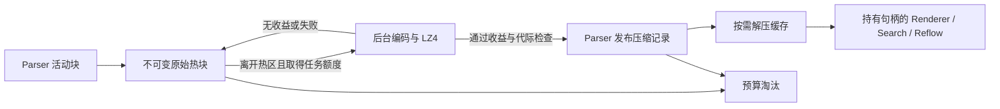

# LZ4 终端历史压缩实施计划

日期：2026-10-17。实施更新：2026-10-19。状态：**可选压缩已接入，默认关闭；性能发布门槛及长稳/跨平台验收未完成**。

目标：所有类型终端（LocalShell、SSH、Telnet、Serial）长时间接收日志时，
用无损压缩降低历史内存占用，在相同
预算内保留更多历史，同时维持接收吞吐、滚动、搜索和窗口缩放的正确性。
压缩能力放在共用 Scrollback 后端，Serial、SSH、Telnet、LocalShell 均可受益。

本计划以 `docs/ARCHITECTURE.md` 和当前源码为准，属于 P4 的增量特性。
P4 原有完成记录继续保留；不得将本计划或引入 LZ4 源码写成压缩功能已完成。

## 1. 当前实现与接入难点

| 位置 | 当前行为 | 实施影响 |
| --- | --- | --- |
| `third_party/lz4-1.10.0/` | 官方 v1.10.0 完整源码，提交 `ebb370ca83af193212df4dcbadcc5d87bc0de2f0`；未接入构建 | 使用基础 block API，仅编译 `lib/lz4.c` |
| `ChunkedScrollback.h` | 默认不限行数，按约 1 GiB 保守记账预算淘汰，1024 逻辑行/块 | 保留有限内存策略，增加按字节封块和压缩记账 |
| `ScrollbackTypes.h` | 每行持有 `std::vector<Cell>`；封存块保存完整行数组 | 增加压缩表示与不解压即可读取的行索引 |
| `ScrollbackSnapshot` | 共享不可变块；`lineAt/lineById` 返回裸指针 | 读取必须显式持有解压数据，不能让缓存淘汰使指针失效 |
| `ChunkedScrollback.cpp` | 尾行可能被 continuation 改写，resize 通过 `takeNewestTail` 取回历史 | 活动块和近期尾块保持可写/易读，旧快照继续看到原值 |
| `tailFrom` | 高频尾部增量，读取首尾 ID 和深拷贝少量尾行 | 首行 ID 查询不能导致每帧解压最旧块 |
| Search/Reflow/Renderer/Core 上下文 | 均读取历史，部分代码直接访问 `chunk->lines` | 必须统一经过受控访问器，避免各消费者自建无限缓存 |

旧 P4 文档和 AGENTS 的部分历史记录仍写 256 MiB；本次基线取当前
`ChunkedScrollback::DefaultMaxBytes` 的 1 GiB，不修改历史实测表来伪造新成绩。
现有 byte budget 是 live history 的保守估算，并不是进程 RSS 硬上限；旧快照
保留的块单独记账。压缩计划必须保留并说明这个区别。

## 2. 范围与明确选择

首版使用 **LZ4 普通模式、独立分块、无跨块字典**。
压缩调用 `LZ4_compress_default()`，解压使用 `LZ4_decompress_safe()`；
不引入 HC、frame、CLI、磁盘存储或其他压缩算法。

最新内容保持原始 Cell 表示，较旧封存块交给后台压缩。收益不足或压缩失败
时保留原始块，并继续遵守内存淘汰策略。停止、关闭和队列满时不等待压缩
完成来维持接收，也不承诺压缩后历史永不淘汰。

新增核心文件仅使用标准 C++17 与项目核心类型，不包含 Qt 或 libvterm 头；
Qt 配置、系统可用内存查询和 UI 提示留在现有门面/服务/UI 层。
不恢复已暂停的搜索匹配器注入或开展核心去 Qt 化重构。

注意：当前 `TerminalTypes.h` 和 `ScrollbackTypes.h` 仍包含 `QMetaType`，
不能仅凭 codec 没有直接 include Qt 就宣称可无 Qt 编译。步骤 1 先将 codec
需要的纯数据声明抽到无 Qt 头，原头保留兼容 include 与元类型声明；只调整
这条数据依赖链，不迁移 QObject 门面，也不恢复已暂停的搜索工作。

### Qt 耦合检查与实施边界（2026-10-17）

检查结论：LZ4 本身无 Qt 依赖；现有历史数据头、宿主 core 目标和接线层仍
依赖 Qt。新增压缩后端必须独立于这些 Qt 入口，不能只以源码中没有 `Q*`
类型或 codec 单项链接成功来判断整个压缩特性已经解耦。

| 耦合路径 | 当前证据或计划缺口 | 实施约束 |
| --- | --- | --- |
| 数据头传递依赖 | `ScrollbackSnapshot.h` → `ScrollbackTypes.h` → `TerminalTypes.h`；后两者包含 `QMetaType` | 抽出纯数据头，codec、块/句柄、snapshot、缓存和服务都引用纯头；旧头仅供兼容调用者使用，保留元类型声明且不得重复声明同一类型 |
| 链接依赖 | 根 CMake 的 `novaterm_core` PUBLIC 链接 Qt Core/Gui | 新建 `novaterm_history` STATIC 承载纯历史后端，PRIVATE 链接 LZ4，必要的标准线程依赖使用 `Threads::Threads`；core 单向依赖 history，history 不链接 core 或任何 Qt 目标 |
| 线程与通知 | 服务计划接入 `TerminalCore::Runtime`，未明确唤醒接口类型 | 使用 `std::thread/mutex/condition_variable/atomic`；完成队列及唤醒通过纯 C++ 接口/回调注入，不接收 `QObject*`、Qt 信号槽、`QThread`、`QTimer` 或 Qt 事件循环 |
| 配置和交互 | `ConfigManager`、TerminalView/Renderer、TerminalCore 门面及 Search/Reflow 当前使用 Qt | Qt 层将配置转换为纯策略值，读取纯统计/状态；服务不读取配置单例、不引用这些消费者头。重绘/提示的 Qt 投递放在门面适配处 |
| 自动生成与测试 | 根工程查找 Qt，现有 scrollback 单测使用 Qt Test；仅测 codec 不能覆盖后台服务 | LZ4、history 和无 Qt 验收目标都显式关闭 AUTOMOC/AUTOUIC/AUTORCC；提供不经过根工程 `find_package(Qt...)` 的独立验收入口 |

纯数据头承载 Cell/颜色/属性、LogicalLine/LineId、不可变块、策略、统计和
读取状态，不复制第二套同名数据模型。`ScrollbackSnapshot` 等纯后端直接
依赖这些头，不能经旧兼容头重新引入 `QMetaType`。`LineLayout.h` 与
`SearchEngine.h` 当前包含 QObject，继续作为消费者，不能成为 history 的
头文件依赖。OS 线程命名复用 `ThreadNaming`，它只依赖标准库与平台 API。

依赖方向固定为：`Qt 配置/UI/现有 core 门面 → novaterm_history → LZ4`。
完成通知在服务线程只负责写入有界 mailbox 并调用不阻塞的唤醒接口；适配
对象持有共享 mailbox/失效令牌，关闭时撤销订阅，不能捕获无保护 Core
裸指针。GUI 冷读的 Qt 事件投递由适配层负责，纯后端无需 Qt 事件循环
即可压缩、解压、取消及停止。Qt 应用中的既有宿主依赖仍保留，本项不宣称
整个 `novaterm_core` 已去 Qt。

### 最小耦合约定

将低耦合作为实现与评审的验收条件。职责按下表分开，接口只暴露调用者
需要的操作；通过少量值类型和拥有型句柄组合，不为首版引入通用插件框架。

| 边界 | 对外契约 | 内部细节 |
| --- | --- | --- |
| Cell/行与策略数据 | 同一套纯 C++ 数据声明、预算值、状态枚举、UTF-8 错误信息 | 不含 QObject、配置键、翻译文本、串口/会话对象 |
| 块编解码 | `ScrollbackBlockCodec` 接收不可变行与显式限额，返回结果/错误 | `lz4.h` 只在 codec 实现中包含；LZ4 类型、宏、工作区和错误值不进入公共头 |
| 历史存储与读取 | 追加、快照、索引查询、pin/cursor、统计和明确的读取状态 | Raw/LZ4 payload、缓存容器、LRU、压缩格式和队列结构不向 Renderer/Search 暴露 |
| 后台调度与资源额度 | 显式注入共享运行时、存储注册令牌、有界任务/完成 mailbox 与非阻塞唤醒 | 不查找 Core/Session，不访问 GUI，不把底层 mutex 或缓存锁交给消费者 |
| Qt 接线 | 现有门面转换配置、接收状态并调度重绘/提示 | Qt 元类型、信号槽、配置路径和 UI 文案仅存在于适配端 |

序列化器只处理数据，既不调度线程也不选择淘汰策略；存储负责 live 索引
和淘汰；共享运行时负责预算、缓存与后台任务。禁止服务通过 friendship、
裸指针或回调绕过 Parser 修改存储。消费者只依赖快照/读取契约，不依据
块是否压缩选择代码路径，也不自行调用 LZ4 或维护第二套解压缓存。

应用组合入口显式创建进程共享的历史运行时并注入各存储；跨终端预算与
队列通过此实例协调，不使用隐式单例或静态可变注册表。测试可创建独立
运行时并注入轻量唤醒接收端，无需构造 Session、Renderer 或 Qt 应用。
注册令牌的撤销、在途通知和运行时关闭顺序须有明确所有权与同步约定。

适配代码放在当前已有 Qt 依赖的门面/应用层，不能为方便接线加入纯后端
源文件或公共头；也不为本特性提前开展整套 coreqt 迁移。兼容类型头仅
转发纯声明并保留必要元类型声明，不复制结构或长期维护两套读写 API。

`novaterm_history` 的 LZ4 include 目录与编译选项均为 PRIVATE，消费者只
取得 history 的公共 include 路径；静态链接所需的 LZ4 链接关系由 CMake
目标传播。目标定义由根工程与独立无 Qt 入口复用，不能借用根工程 Qt
include 路径、全局 link_directories 或另一份手写的源文件清单。

### 初始参数

下表是待 A/B 验证的初值，不是已测得的最优配置。统一放在策略结构中，禁止
散落为各消费者的魔数；基准可以覆盖，普通 UI 首版只提供压缩开关。

| 参数 | 初值 | 约束 |
| --- | --- | --- |
| 历史 live budget | 沿用每终端 1 GiB | 包含原始/压缩块及其行索引，不能只统计压缩 payload |
| 目标封块大小 | 解码后 Cell 与行容器估算 512 KiB | 同时保留 1024 行封块条件，任一达到即封存 |
| 普通块最大解码占用 | 1 MiB | 编码缓冲、LZ4 输出上限另行预留；逐行追加前检查 |
| 热区 | 活动块及最近 4 MiB 封存块 | 不预分配；至少保留最新逻辑行所在块不压缩 |
| 最小压缩块 | 原始占用 32 KiB | 碎块不强求压缩，先修封块粒度而非制造大量任务 |
| 采用压缩结果门槛 | 总记账至少节省 12.5%，且至少 4 KiB | 比较完整压缩表示与完整原始表示，含索引和容量 |
| 后台压缩 worker | 每进程最多 1 个，按会话轮转 | 空闲阻塞等待，无周期扫描；性能验收后再决定是否扩容 |
| 等待压缩队列 | 每进程最多 32 个任务且源块 charge 合计不超过 16 MiB | worker 在途源块/临时内存另计；满即保留原块，不阻塞 Parser |
| 解压驻留缓存 | 每终端至多 8 MiB、进程合计至多 32 MiB | 已 pin 的对象计入限额，不能从 LRU 移出就视为释放 |
| 编解码在途工作区 | 每进程至多 16 MiB，包含 Parser 预留槽 | 先申请额度再分配，缓存与临时空间不能重复漏计 |

单个逻辑行可能超过 1 MiB。首版将它作为**不可压缩的独立原始块**，计入
原有历史预算，继续执行超预算淘汰；不能截断、拆散 LineId 或在每次追加
continuation 时重复封块/压缩。单行异常大时的原有内存边界需单独回归。

## 3. 数据表示与无损格式

引入 `ScrollbackBlockCodec`，把逻辑行序列编码成显式字段格式，再做 LZ4。
禁止 `memcpy(sizeof(Cell))` 作为正式编码：结构体有 padding、ABI 和 bool
表示差异，且不能据此安全校验解码分配量。

第一版按固定宽度、小端字段编码，不同时引入样式字典或复杂 RLE：

- 块头：格式版本、编码方式、行数、原始序列化长度、压缩长度、解码分配上界。
- 行索引：LineId、hardBreak、Cell 数、编码偏移；支持按行号和 LineId 二分，
  查询首尾 ID、行数、Cell 数和淘汰统计无需解压。
- Cell：全部 `chars[MaxCharsPerCell]`、width、所有属性位、underlineStyle、
  前景/背景的 type/index/RGB；保留宽字延续标记和所有已有语义字段。
- 校验版本、枚举、保留位、偏移单调性、长度加乘溢出、行/Cell 总数及解码
  后内存上界；转换为 LZ4 `int` 参数前验证范围。
- 压缩结果返回 0 时不得使用输出；解压返回值必须恰好等于声明的原始长度。
  结构校验失败返回明确错误，不能将错误当空行或静默跳过整个块。

`LZ4_decompress_safe` 提供边界检查，不提供完整数据完整性校验保证。
首版是内部内存格式，不声称具备持久化恢复或任意位翻转检测能力；如以后
落盘，需要单独定义校验和、格式兼容及恢复协议。

字符变长编码、相同样式合并可以作为后续独立优化；必须用相同 LZ4 参数
与首版做 A/B，不能把两项收益混成一个未经验证的“LZ4 压缩率”。

## 4. 所有权、读取句柄与状态转换

保持“Parser 单写文档，消费者只读”的边界。使用不可变块记录承载行索引
与 Raw/LZ4 payload；压缩完成后，由 Parser 验证并替换 live 索引中的记录。
worker 不修改 Parser 容器、不修改原始块，也不直接操作 QObject、Session 或 UI。



### 读取接口先迁移

新增 `PinnedHistoryLine` 一类拥有型读取句柄：共享持有不可变的原始或解压块，
并指向其中一行。缓存淘汰只解除缓存所有权，不使正在读取的句柄失效。
禁止依赖 thread_local 单行缓冲、每快照永久累积解压块，或“一次新查询使
上次裸指针失效”的隐式约定。

活动块依然由 Parser 修改；不能把它包装成 `shared_ptr<const ...>` 就当作
不可变数据跨线程发布。读取活动行应沿用模型锁内访问，或复制所需行形成
独立不可变句柄，复制占用同样记账。

迁移 `ScrollbackSnapshot::lineAt/lineById`、`ChunkedScrollback::lineAt`、
`ScrollbackBuffer::logicalLineAt/lineVectorAt` 及所有调用者。明确区分
`Found`、`NotFound`、`Pending/Busy`、`DecodeError`，不能用 nullptr 混淆它们。
rowForLineId、contains、tailFrom 的首尾定位只访问索引。

Search/Reflow 使用自己的顺序读取 cursor，可复用最近解压块；缓存和 pin
统一取得额度。viewport 读取优先，顺序扫描不把整个历史灌入共享 LRU。
一次解压后的结构化 Cell 分配也必须计入缓存，不能只统计序列化字节。

### 冷读与交互延迟

GUI 对冷块缓存未命中时提交有界解压请求，显示待加载状态并保留上一份
有效视口；完成后按视图/布局代际请求重绘，避免每帧重新提交相同请求。
Search/Reflow 可在各自 worker 上同步解压单块，等待额度时可取消。
同一冷块的并发请求合并，失败请求不能无限重试。

Parser 的 `sb_popline`/缩放回填是同步语义：近期热区直接读取；越过热区时
允许受 1 MiB 普通块边界约束的解码，不能等待后台队列或缓存额度，也不能
调用 UI。为此预留一个 Parser 解码工作槽并单独记账。必须测量模型锁持有
时间和 resize 延迟；若达不到第 8 节门槛，先实现有界预取/分批 resize，
不能以“通常在热区”作为正确性或延迟保证。

预留槽属于进程 16 MiB 工作区总额度，并非每个终端额外获得一份无限扩展
的额度。启用某个 Core 的压缩前，按普通块最坏解码峰值预留该槽，且为
后台 worker 留出至少一个任务的峰值空间；额度不足时该 Core 保持原始
存储并报告原因，不产生无法同步回填的压缩块。槽须覆盖序列化输入、Cell
容器和分配开销；直到该 Core 及其遗留压缩记录不再需要回填资源才释放。
1/4/8 会话验收必须记录实际获准压缩的数量，降级会话不能算作 ON 性能成绩。

MCP/文本捕获沿用既有长度、时间和 Busy 契约：不能在模型锁下等待解压。
需要冷数据时先取得不可变块句柄，锁外读取；预算不足显式 Busy，完整率和
延迟同时报告。`tailFrom` 的跨热区追帧也必须有显式重同步/后台重排路径，
不在 GUI 持锁循环里同步展开大量冷历史。

### 异步生命周期

任务携带块记录身份、存储 epoch、块 ID 及策略代次。每次 clear、存储重建、
关闭和策略失效都使相应任务失效；不能只用会话连接 generation，连接重连
可能保留历史，历史 clear 也不一定改变连接 generation。

结果由有界完成队列交还 Parser，通过现有核心唤醒链唤醒，不使用轮询；
应用时核对 live 块仍是被提交的同一记录且尚未淘汰。旧结果只释放内存。
新 worker 入口第一行设置 OS 线程名 `nvterm-history`。

关闭停止接收任务、丢弃等待队列，只允许当前有限单块操作收束；不排空
全部历史任务。结果状态不得回调已析构 Core。应用退出显式停止并回收共享
worker，不泄漏线程，也不按终端数量累积 join 等待。

## 5. 内存预算与淘汰

分别维护 live、retained、cache、temporary 四类 charge：

```text
historyResidentCharge = liveRaw + liveCompressed + liveMetadata
                      + retiredOrReplacedPinned
                      + decodedCacheAndPins + codecTemporary
```

每份真实分配只计一次；多个快照/任务引用同一 payload 不重复累加。
压缩结果提交前，源块、序列化输入、压缩输出、索引和容器 capacity 同时存在，
必须预留这段峰值。采用压缩后，旧快照仍可能持有 Raw 版本，只有实际释放
才减少其 charge；不能在发布压缩记录时假定原始内存已经归还。

淘汰保持最旧内容优先；压缩与原始块使用同一策略。部分行被淘汰但不可变
payload 尚未释放时，仍计算整个分配，不按有效行比例虚减。tail 改写和
`detachedBytes` 需重新推导，不能沿用原始 `Cell::byteSize` 扣减压缩 payload。

压缩任务不是额外的保存承诺。预算压力时先释放未 pin 的缓存、取消等待
任务，再按原策略淘汰；不可压缩数据仍受预算约束。缓存被全部 pin 时返回
Busy/延后加载，不允许绕过限额分配临时“备用缓存”。

新增统计至少包含：rawBytes、compressedBytes、metadataBytes、retainedBytes、
decodedBytes、pinnedDecodedBytes（decodedBytes 的子集，不重复相加）、
temporaryBytes、压缩前逻辑字节、压缩/跳过/失败次数、任务队列高水位、
缓存命中/未命中、淘汰行数及存储错误计数。保留既有统计字段时写清新含义。

多终端依然可能各自接近 1 GiB，压缩不等于全进程内存上限。共享缓存、队列
和工作区必须有上述进程总上限。首版增加总历史 charge 诊断与内存压力提示；
自动调整全局历史额度及跨终端公平淘汰作为独立后续策略，不在本次偷偷改变
其他标签的保留容量。若全机内存不足，必须如实提示，不能承诺无限保存。

## 6. 分阶段实施与文件清单

每阶段先写能证明需求的回归并观察失败，再实现并运行相关测试。保持每步
可构建；前四步关闭生产压缩，避免半迁移接口进入用户路径。

| 步骤 | 工作与主要文件 | 完成判据 |
| --- | --- | --- |
| 0. 基线 | `tests/benchmarks/core/ScrollbackBenchmark.cpp`、`tests/benchmarks/serial-stress/`；新增可重复日志语料生成与 JSON 报告 | 固定负载、参数、种子、内容哈希，记录未压缩 Release 基线与现有测试结果 |
| 1. LZ4 与 codec | 声明 `novaterm_lz4` 与 `novaterm_history` 静态目标；抽出无 Qt 数据声明，原类型头保持兼容；新增 `ScrollbackBlockCodec.h/.cpp` | LZ4 只编译 `lib/lz4.c`；core 单向依赖 history，history PRIVATE 链接 LZ4；纯目标关闭 Qt 自动生成，往返/拒绝输入及无 Qt 链接检查通过 |
| 2. 拥有型访问器 | `ScrollbackTypes/Chunk/Snapshot`、`ChunkedScrollback`、`ScrollbackBuffer`、`TerminalCore`、`SearchEngine`、`LineLayout`、`TerminalRenderer` | 所有读取迁移到 pin/cursor，原始表示下原有回归通过；索引查询不物化 Cell，无残留直接访问冷块 `lines` |
| 3. 表示与记账 | 新增不可变 Raw/LZ4 block 记录和有界解码缓存，改 `ChunkedScrollback`；纯存储实现归入 history 目标 | 可同步注入压缩块做测试，原始/压缩/retained/cache/temp 计数与释放正确，预算压力不会产生额外无限缓存；同一源文件不重复编入 core 与 history |
| 4. 后台服务 | 新增纯 C++ `HistoryCompressionService.h/.cpp` 归入 history；应用组合入口创建并注入共享历史运行时；TerminalCore::Runtime 通过注册令牌/mailbox/唤醒适配接口接入 | 公平调度、有界请求/结果队列、clear/close/尾行改写/淘汰竞争测试通过；无 Qt 事件循环下服务可完成并停止，worker 不持有 UI/QObject 裸指针，不依赖全局单例 |
| 5. 冷读接线 | Renderer 冷视口加载、Search/Reflow cursor、Core 捕获与 resize 回填 | 读取期间 pin 不失效，Pending/Busy/Error 处理明确，首尾索引和实时 tailFrom 不触发历史全量解压 |
| 6. 配置与展示 | `ConfigManager`、设置页、`TerminalView`/Core 门面、`SessionFactory`、翻译资源 | 新建和已打开/外部注入 Core 都应用策略；支持开关、显示节省量与失败/淘汰提示，旧配置升级不恢复行数限制 |
| 7. 性能与收尾 | 相关测试、benchmark、README、AGENTS、架构及 P4 文档 | 第 7～8 节验收有可追溯数据；达标后才默认启用，否则功能保持可选并公开缺口 |

步骤 1 不直接 add_subdirectory 上游 `build/cmake`，避免引入 CLI、install、
CPack 和上游选项。LZ4 `lib/` 的 BSD-2-Clause 许可随产物保留；完整源码树
其他文件的许可按既有文档保留。静态库消费者需确认最终可执行目标正确链接
LZ4；无 Qt 验收必须覆盖完整 history 后端，不能据此宣称整个 core 已去 Qt。

新增 `novaterm_history_no_qt_link_check`，仅依赖 history/LZ4、标准线程及必要
平台库，不使用 Qt Test。步骤 1 先执行 codec 往返，步骤 3～4 扩充到混合
快照/句柄、缓存预算、后台完成投递、clear/取消与 stop/join。提供
`tests/history-noqt/CMakeLists.txt` 独立入口，复用生产 history 目标定义，
在无 Qt 头文件/库搜索路径的环境配置、编译、链接和运行；不通过链接
`novaterm_core` 绕过检查，也不维护另一份被简化的测试专用服务实现。

配置拟用 `terminal.historyCompression.enabled`，正式发布前默认 false，
验收达标后默认 true；调试/基准可覆盖策略参数。关闭时停止新压缩，已有
压缩块继续按需读取，不一次性展开整个历史。重新打开时逐步调度旧块。
开关不清历史、不重置 LineId，也不要求重连串口。

## 7. 正确性与故障测试

优先扩展 `novaterm_scrollback_tests`、`novaterm_core_tests` 和已有 renderer/
session 测试；纯 history 增加上述轻量无 Qt 目标。新测试注册同步更新 README、
AGENTS 的清单和实际 `ctest -N` 结果，不凭记忆增加总数。

- **字段往返**：中文、Emoji、6 个组合码点、宽字延续、空行、尾空格、
  默认/索引/RGB 色、全部属性、hardBreak、LineId 和单行多次 continuation；
  比较各语义字段，不比较结构体 padding。
- **输入拒绝**：未知版本、截断/损坏 payload、解压长度不符、超额行/Cell 数、
  伪造解码上界、偏移溢出及超 LZ4 int 范围；不能分配不受控内存或静默丢行。
- **混合表示**：原始/压缩块交替，首尾 ID 与文档行定位、部分淘汰、0 行/
  0 字节预算、不可压缩数据、超长行 fallback、最新块 continuation 与 popline。
- **生命周期**：旧快照跨替换/clear/淘汰仍可读；pin 跨缓存淘汰、跨线程并读
  有效；释放后计数下降；等待/结果队列满、worker 异常、关闭中压缩、
  连续启停及不同 epoch 的迟到结果不会复活历史。
- **功能联通**：冷块复制/选择、跨块搜索坐标、搜索取消、冷区反向滚动、
  缩放往返、历史与活动屏幕接缝、备用屏、清除历史/全部清除、MCP Busy
  与截断语义、断开重连后旧历史仍可回看。
- **多终端**：1/4/8 会话并发，一条高流量不能饿死其他会话；验证进程级
  队列/缓存/临时额度，不让每个读者各自额外占一份全额缓存；Parser 槽
  申请失败、已有压缩历史关闭开关及遗留快照释放时的额度归还均有覆盖。
- **依赖隔离**：独立无 Qt 验收入口实际编译生产后端；检查传递头和链接
  命令不含 Qt，且不创建 QCoreApplication；Qt 门面联通测试另行运行，
  两类测试不能相互替代。结果报告分别说明已验证 codec、存储和服务范围。
  同时编译只使用公共读取 API 的最小消费者，不提供 LZ4 include 路径，
  验证 LZ4 实现细节未泄漏。依赖检查拒绝 history 引用 Qt、Session、
  Transport、Renderer 或 ConfigManager 头；独立运行时可反复创建/关闭，
  不在测试之间残留注册、缓存或后台线程。

日常按阶段只跑相关测试。最终改动涉及核心数据布局及多个模块，按 AGENTS
要求构建全部默认目标、运行当前平台完整 CTest，并对照已知失败做基线判断。
Windows 的 GUI 测试启动失败要先定位环境，不将“零 stdout”当测试通过。
ASan/UBSan、TSan 在可用平台分别记录；未执行 LSan/真实串口就明确写未验收。

## 8. 性能验收与发布门槛

语料包含重复 ASCII 日志、带时间戳/随机数字日志、CJK/Emoji/ANSI 样式混合、
高熵不可压缩负载、超长单行及频繁局部改写。串口夹具核对序号、总字节与
哈希；合成语料不能代替真实 UART/USB 驱动验收。

对比 OFF/ON：同机 Release、相同语料、相同输入/历史预算/窗口和可见状态，
每项独立进程至少 3 次，报告中位数、范围及 P95/P99；采集当前/峰值 RSS。
既比较“相同内容的占用”，也比较“相同预算的保留量”。后者搜索更多内容，
不能直接拿总搜索时间认定算法退化，需同时报告扫描 Cell/s 和首次结果延迟。

以下是发布验收目标，实施前不作为已达成事实：

| 指标 | 门槛 |
| --- | --- |
| 数据正确性 | 所有已保留历史逐字段一致；受控接收无新增丢帧/丢字节；队列/容量拒绝有明确统计 |
| 内存收益 | 固定重复日志和带变量普通日志，两类同内容总 history charge 均至少下降 40%；不可压缩负载没有无收益的双份长期存储 |
| 接收吞吐 | 相同内容/足够预算下中位吞吐不低于 OFF 的 90%；原 P2 20 MiB/s 在基线已达标的同机仍达标，多串口目标速率不积压 |
| 接收 CPU | 固定速率测试，ON 总 CPU 时间/接收 MiB 相对 OFF 增幅不超过 20%；同时报告实际节省内存 |
| 回看 | 热区 frame CPU P95 相对 OFF 增幅不超过 10%；冷视口请求到正确画面 P95 ≤ 50 ms，P99 ≤ 100 ms，单独报告 GUI 帧延迟 |
| 索引/尾部 | 首尾 ID 与 contains 不解压；near-tail `--tailfrom-scale` 保持通过，不随冷块数线性扫描 |
| 搜索/重排 | 等量 Cell 的扫描吞吐不低于 OFF 的 80%；取消 P95 ≤ 50 ms；正确结果不能以减少扫描范围换取 |
| 缩放/关闭 | 强制跨越热区的 resize 无内容变化/死锁；模型锁持有 P99 相对 OFF 增量 ≤ 2 ms；停止调度不排空全历史，单次关闭新增压缩等待 ≤ 50 ms |
| 长稳 | 1/4/8 会话持续输入及回看/搜索至少 30 分钟，预算进入平台后 cache/queue/temp 无单调增长；会话关闭后资源按所有权释放 |

达不到门槛时按瓶颈调整块大小、热区或缓存，并保留每次结果；不得仅提高
内存预算、隐藏 Busy 或降低日志速率来制造达标。真实串口与 GUI 性能使用
现有 Windows 手工夹具，不自动占用用户端口或让机器休眠。

## 9. 文档、交付与后续边界

实施时同步 `ARCHITECTURE.md` 的所有权/数据流/预算、P4 增量记录、README
开关与容量说明、AGENTS 依赖/测试/易错点；阶段状态变化同时更新架构索引
和 Development_Roadmap。新增接口在头文件写明句柄寿命、Busy、错误、停止
语义，不能只把这些约定留在本计划里。

实施记录应逐步填写：提交/工作树标识、编译器/平台、参数、RED/GREEN、
测试名、基准 JSON 路径和已知缺口。实施前完成项仅为 LZ4 源码引入与本计划；当前实现与验收见下方实施记录。

独立后续项：日志持续落盘、磁盘历史加载、全进程 live 历史公平预算、样式
RLE/字典编码。它们不作为本次压缩已经实现的能力；长期完整留存仍需落盘。

### 进度

- [x] 引入并核对官方 LZ4 v1.10.0 完整源码与许可证。
- [x] 检查现有 Scrollback/快照/消费者接口并编写实施计划。
- [x] 步骤 0：基线与可重复负载。
- [x] 步骤 1：静态库与无损 codec。
- [x] 步骤 2：拥有型读取接口迁移。
- [x] 步骤 3：压缩表示、解码缓存与记账。
- [x] 步骤 4：后台压缩服务与生命周期。
- [x] 步骤 5：冷读、搜索、渲染与 resize 接线。
- [x] 步骤 6：配置开关、诊断与翻译。
- [ ] 步骤 7：跨模块回归、性能/长稳验收和发布文档。

### 实施记录（2026-10-19，验收基于工作树，交付提交见 Git 历史）

平台为 Windows 10 x64、MSVC 19.51.36256、Qt 6.8.3、Ninja Release。
最初基于 f067c91，保留已有 LZ4 源码/计划/.gitignore/架构文档改动；推送前发现
远端另有 6 个 MCP 提交，完整 stash 备份后快进至 7475adb，再恢复所有本地改动。
AGENTS.md 尾部记录冲突取双方并集。远端 Windows 严格编译的两处遮蔽与一处
if constexpr 后不可达 return，以及测试变量 stdout 与 Windows CRT 宏冲突作
局部语义等价修复，不改变 MCP 契约。

| 步骤 | 实施与验证范围 | 证据/限制 |
| --- | --- | --- |
| 0 | 五类固定种子语料、独立进程与 JSON；字段哈希、容量、RSS、追加/扫描/读取分位数 | benchmarks/history-2026-10-17/ 下保存每轮结果；固定频率接收 CPU/GUI/WPR 尚未采样 |
| 1 | 纯 TerminalData/ScrollbackData，codec 固定小端字段，私有 LZ4；完整上游零修改 | 字段往返、版本/枚举/长度/索引/额度拒绝；不把位翻转检测或持久化恢复列为已实现 |
| 2 | Snapshot/Chunked/Buffer/Core/Search/Reflow/Renderer 拥有型读取迁移 | 原始表示五项回归通过；活动行复制，不把可变 active 假装成不可变共享 |
| 3 | Raw/LZ4 混合记录、共享解码额度、pin、分配 token 与旧快照计数 | 部分淘汰计算完整 payload；关闭 Core 后旧快照分配仍计入共享统计，最终释放归零 |
| 4 | 单 worker、源/任务/完成队列边界、轮转、冷读优先、epoch/mailbox/wake | 独立无 Qt 测试覆盖完成、clear、取消、关闭、stop 重复、旧任务、8 申请/4 批准；故障注入与竞态的穷举矩阵仍可扩充 |
| 5 | CacheOnly 冷视口、顺序 cursor、MCP Busy、后台复制、Parser 同步槽 | Core 定向测试跨块搜索/冷视口/关闭压缩后的 resize 往返和 clear；真实 GUI 帧延迟/锁 P99 仍未测 |
| 6 | 所有终端类型共享策略，新建/已打开/外部 Core、设置开关、诊断和中英翻译 | 四种 Transport 标签的内存 Session/View 定向测试通过，不连接真实服务器或端口 |
| 7 | 完整默认构建/CTest、独立干净无 Qt、依赖审计、OFF/ON 与文档 | 最终具体结果追加在下方；未达发布门槛，继续默认 false |

实施中的 RED/GREEN 如实区分：原始五项测试在沙箱内 0xc0000142（DLL 初始化失败），
放开运行后在改动前 5/5（19.03 s）；读取迁移后同五项 5/5（36.17 s，期间有编译负载）。
独立入口最初因未加载 MSVC、UTF-8 选项和中文 Ninja 依赖探测失败；修正后编译运行通过。
这些是环境/构建红灯，不冒充每个功能测试的预先 RED；新增功能回归随阶段实现补入，
并非每个步骤都完成了计划所要求的先观察失败的完整 TDD 流程。

独立验收不是 codec-only：`tests/history-noqt` 直接复用生产目标，编译 codec、
ChunkedScrollback、Snapshot/Chunk、缓存预算、后台服务和 ThreadNaming。
最终干净目录为 `build/history-isolated-final`，配置显式清空 CMAKE_PREFIX_PATH、
屏蔽 Qt 前缀并关闭包注册表；没有 QCoreApplication，也不提供 LZ4 include 目录。
`novaterm_history_no_qt_link_check` 实际运行通过；dumpbin 的 DLL 依赖只有 Windows/
MSVC/UCRT，没有 Qt。公开头传递审计见 dependency-audit.json，不包含 Qt/Session/
Transport/Renderer/ConfigManager/LZ4 头。这不代表整个 novaterm_core 去 Qt。

与初始计划的保守实现选择：

- 4 MiB worker 槽中最多容纳 1 MiB 已完成 payload，其余给有限单块峰值，mailbox 满
  则保留 Raw。队列计数包含在途和未消费完成项，最多每存储 2 个压缩任务并另留冷读槽。
- 解码缓存把序列化临时空间一起保守计入 8/32 MiB，并保持该预留随 entry 生命周期；
  统计不是 allocator/RSS 的逐字节数，不能把 pinnedDecodedBytes 重复相加。
- 新 runtime 不替换已注册的活存储资源域，避免外部 View 附着将已有块拆到另一预算。
  Core 关闭传空撤销通知；遗留快照仍可同步读，不等待已经析构的宿主。
- GUI 冷视口失败不以空行冒充成功，保留上一份画面；显示 Pending/Busy/Error，失败块
  不无限重试。Busy 后需要额度释放并重新请求，当前不承诺所有额度争用都自动重试。
- 冷选择复制由 Qt 适配层后台消费快照，单视图最多一个任务，最多 64 MiB 文本；
  超限/解码错误明确失败，不把截断文本写入剪贴板。Search/Reflow 可取消地等待额度。
- 普通块边界与 Parser 槽提供正确性保障；模型锁 P99、强制冷区 resize 延迟和关闭
  新增等待 ≤50 ms 仍需量化，不能把正确性回归通过写成这些性能指标通过。

发布缺口保持公开：独立后端语义/Qt 联通已有验证，但冷扫描性能不足，固定频率
接收 CPU、真实接收吞吐、GUI 冷视口 P95/P99、完整复制大选区交互、锁 P99、关闭
P95、1/4/8 会话各 30 分钟长稳、ASan/UBSan/TSan/LSan、Linux/macOS 及真实 UART
尚未完成本轮验收。合成负载不替代 UART/USB 驱动；没有占用用户端口。

安装验证：`cmake --install build/Release --config Release --prefix
D:/qt/NovaTerm/build/history-package-check` 成功，实际包含
`share/doc/novaterm/LICENSE.lz4`；其 SHA256 与上游 lib/LICENSE 一致：
`8b58c446121a109ccf32edc094bba3010a3d85e4ee3702950db55e4d3e87736c`。
本项验证的是本地安装树，未将 ZIP/DEB 的部署成绩混入压缩性能报告。

### 最终验收结果（2026-10-19）

- Windows Release：全部默认目标构建成功，`ctest -N` 实核 35 项；全套 **34/35，通过项耗时合计/总时长见 JSON，总时长 371.66 s**。唯一失败为 `novaterm_conpty_tests`。
- ConPTY 完整文件日志复跑：10 通过/2 失败，98.227 s，仅 `injectedStartupStagesRollBack` 末条句柄断言与 `repeatedLifecycleReturnsResourcesToBaseline`，与 AGENTS 已知平台泄漏吻合。该目标不链接 history，未改其生产源或测试。
- Core 新冷视口/跨块搜索/跨热区 resize、四类终端及外部 Core 配置、完整无 Qt 生产后端、renderer 与 terminal-session、tailFrom 缩放护栏均通过。串口取消发布竞争本轮全套及定向 6/6 通过，历史失败记录保留，不归功于本次修复。
- 干净无 Qt 独立构建 1/1（0.19 s）；增加压缩块部分淘汰回归后再通过。根 no-Qt 目标最终专项 1/1（0.15 s）。只有 benchmark 节拍参数在全套后追加，重新构建全部默认目标并验证 benchmark JSON；生产库未再修改。
- 本轮没有连接真实串口或用户服务器。未测性能指标和平台仍保留上文缺口。

固定内容各 10,000×80 Cell（超长行 100×30,000），1 GiB live budget，独立进程每项 3 次，统计为中位数；包含 4 MiB worker 与获准 ON 的 Parser 预留 charge。

| 语料 | OFF/ON 总 charge（MiB） | 下降 | OFF/ON 追加（ms） | OFF/ON 字段验证扫描（ms） |
| --- | --- | --- | --- | --- |
| repeat | 45.05 / 11.83 | 73.7% | 25.66 / 25.55 | 12.95 / 43.44 |
| variable | 45.05 / 11.92 | 73.5% | 26.00 / 52.78 | 13.21 / 84.39 |
| mixed | 45.05 / 13.31 | 70.5% | 28.78 / 43.65 | 13.46 / 69.00 |
| entropy | 45.05 / 37.57 | 16.6% | 35.32 / 56.43 | 13.44 / 66.79 |
| long | 152.79 / 155.80 | -2.0% | 77.06 / 115.77 | 48.57 / 76.97 |

两类普通日志的内存目标通过；突发追加的吞吐目标并非全部通过，扫描吞吐显著低于 OFF。这里扫描包含逐 Cell 全字段哈希验证，不等于 Qt 正则搜索吞吐；每行 P95/P99 也不是 GUI 冷视口延迟。LZ4 与固定字段内存表示的总体收益合并在此，不宣称全部节省均来自 LZ4 算法。

相同 32 MiB live budget：尽快追加 25,000 行时，普通日志 OFF 保留 7,592 行，ON 7,711 行；后台来不及压缩前发生的预算淘汰无法逆转，不能以最终更低的占用假装这轮已保住所有内容。另测每 64 行请求 sleep 2 ms 的节拍输入，Windows 实际每轮约 6.05 s，OFF 仍保留 7,592 行，ON 完整保留 25,000 行（3.29×），ON 总 charge 为重复日志 12.44 MiB、变量日志 12.65 MiB。该实验的实际速率由 wall time 给出，不把请求的 2 ms 当作实际调度精度或真实串口成绩。

结果路径：`off-baseline.json` 为早期原始基线；`off-on-synthetic.json` 为早期未对全部语义字段哈希的探索轮；`off-on-under-build-load.json` 保留编译负载期间结果；`off-on-final.json` 与 `equal-budget-final.json` 是无编译负载的最终尽快追加样本；`equal-budget-paced.json` 为额外节拍样本；`performance-summary.json` 含中位数/范围。每份记录带种子、内容哈希、参数、保留量、RSS 和分位数。`noqt-build-report.json`/`dependency-audit.json` 保留独立构建与公共头依赖检查结果；DLL 依赖控制台输出已按归档规则清理；`windows-ctest-summary.json` 给出全部 35 项状态与时间。

复测：先按 README 构建 `tests/history-noqt`；PowerShell 执行 `tests/benchmarks/history/lz4/run-matrix.ps1 -Executable build/history-isolated-final/checks/novaterm_history_benchmark.exe`，等预算加 `-Rows 25000 -Budget 33554432`，节拍实验再加 `-PaceMilliseconds 2`。报告必须同时保留尽快追加与节拍数据，不能用后者掩盖突发性能缺口。

结论：可选功能与依赖隔离已实现，自动化正确性回归可用；正式性能发布验收仍未完成，开关保持 false，步骤 7 的发布门槛/长稳复选框继续未勾选。

### f662302 性能基准补充（2026-10-19）

扩展现有无 Qt benchmark，未修改生产实现。schema 2 将生成/字段校验与
append/scan 计时分离，新增进程 CPU、不同块首次 CacheOnly 冷读/随后的热读、
无解码索引定位、空闲关闭；补充 continuation 语料、淘汰后逐行校验、超时与
非法参数拒绝。矩阵各项至少三次独立进程、轮换 OFF/ON 顺序，自动保存
中位数/范围、源/可执行文件哈希及合成门槛结果，`-EnforceGates` 可非零退出。

Windows Release 同内容 1 GiB / 等预算 32 MiB 两组共 72 样本内容校验通过；
重复/变量日志总 charge 节省约 74%，但同内容扫描吞吐仅约 OFF 的 13%，
追加调用吞吐也未达合成门槛。此为后端计量，不能外推 Parser/真实接收性能。
压缩块冷请求到 Found 的 P95/P99 通过后端门槛，未测 GUI frame。
独立后端 CTest 1/1；非法参数、预算淘汰校验及门槛拒绝路径通过。
未新增默认 CTest 项，未重复无关全套。schema 2 不与历史 schema 1 直接比较。

完整数据与范围见 [本轮报告](../../tests/benchmarks/archive/lz4/history-f662302-2026-10-19/README.md)，
复测见 [基准说明](../../tests/benchmarks/history/lz4/README.md)。步骤 7 与发布状态
保持未完成；真实 UART/GUI、多会话长稳及其他平台等缺口仍在。

### Linux 性能复测（2026-10-20，0.2.76）

基于干净提交 `06bae54`，Ubuntu 24.04.5 / i7-14700K / GCC 13.3.0 / Ninja Release，
独立生产后端无 Qt 构建通过。本机无 PowerShell，采用随报告保存的 Python runner，
按原矩阵脚本参数和口径串行运行同一个 schema 2 可执行文件：六类语料的同内容
1 GiB 和等预算 32 MiB 两组各 36 样本，另补重复/变量日志 2 ms 节拍 12 样本。
三次独立进程并轮换 OFF/ON 顺序，**84/84** 样本逐字段/保留哈希校验通过。

- 同内容重复/变量日志总 charge 下降 **73.7% / 73.5%**；追加调用吞吐 ON/OFF
  为 **0.471 / 0.586**，扫描吞吐为 **0.202 / 0.194**。内存目标通过，追加与扫描
  合成门槛未通过。计量口径仍是后端存储调用和 Cell 扫描，非接收吞吐。
- 等预算尽快追加时，普通日志 OFF 保留 7592 行，ON 完整保留 25000 行（3.293×）；
  节拍实验也完整保留。该 Linux 结果不覆盖历史 Windows 突发性能缺口，不能外推
  更高输入速率、其他平台或真实 UART。long 不压缩，保留量差异不归功于 LZ4。
- 实测压缩块冷读分位数通过后端 50/100 ms 门槛，同内容组各轮 P99 最大值小于
  0.48 ms；long 无压缩冷读样本，记未测，不将后端耗时当 GUI 帧耗时。
- 独立后端 CTest **1/1**（0.11 秒），Release tailFrom 缩放护栏 **1/1**（1.66 秒）。

原始样本、中位数/范围、RSS/峰值、进程 CPU、分位数、脚本/构建哈希与复现命令见
[Linux 完整报告](../../tests/benchmarks/archive/lz4/history-linux-2026-10-20/README.md)。未改生产代码或默认策略；
Linux 两路 RSS 采样部分出现 peak 小于当前值，保留原始值并标记记账一致性待校准。
固定速率接收 CPU、Parser/真实吞吐、GUI、Search/Reflow/取消、模型锁、在途关闭、
1/4/8 会话 30 分钟长稳与真实 UART 等发布缺口继续未验收，步骤 7 保持未完成。

### GUI 历史回看性能复测（2026-10-20，工作树）

新增手工 `novaterm_history_gui_benchmark` 与 `run-gui-matrix.py`：使用可见 X11/OpenGL
终端控件，经过 Parser 预填 50000 行，模拟热区滚轮、冷区翻页、滚动条跳转及持续输入
下连续滚轮。variable/mixed 两类语料，OFF、512 KiB/4 MiB 默认、256 KiB 小块、8 MiB
热区四组策略，每组三次独立进程，24/24 进程通过；12288 次请求全部记账，96/96 次
阶段后最终画面像素抽检通过。未修改生产压缩参数/开关，默认 CTest 仍 37 项。

本轮边界为事件投递到目标内容/字形就绪后的 `frameSubmitted`，未测显示器呈现。
每进程 P95/P99 再取三轮中位数；默认压缩的结果为：

| 场景 | variable P95 / P99 ms | mixed P95 / P99 ms |
| --- | ---: | ---: |
| 热区滚轮 | 34.43 / 34.86 | 34.73 / 34.94 |
| 冷区翻页 | 51.33 / 66.72 | 51.28 / 66.73 |
| 冷区滚动条跳转 | 68.24 / 83.41 | 67.63 / 68.21 |
| 持续输入下最新滚动请求 | 34.20 / 35.78 | 34.04 / 34.75 |

连续场景同时报告合并请求：默认组最早合并请求等待 P99 为 81.84 / 66.10 ms，
正确内容更新间隔 P99 为 67.66 / 51.44 ms，不能只用最新请求延迟或 GPU 帧数判断流畅度。
前三项为闭环响应实验，不把闭环更新率当连续滚动帧率上限。

这种合成日志下默认 charge 从 189.28/194.61 MiB 降到 14.98/14.96 MiB；热区 Renderer
CPU P95 中位数相对 OFF 增幅约 3.2%/5.4%。但**冷区 P95 ≤50 ms 未通过**。小块增加
未命中且未稳定改善跳转；扩大热区多用约 4.1 MiB，尾延迟收益在两种语料间不一致。
保留 512 KiB/4 MiB 为后续对照，优先进一步验证冷读预取/合并及唤醒到完整绘制的调度
往返，不能靠增加内存预算宣布发布达标。

新增 Renderer 值类型完成统计与真实 GPU RED/GREEN 检查，防止 Pending 旧画面或已排队
增量帧提前认领新视口。Release 全部目标、Debug 相关目标构建通过，两个配置 Renderer
专项各 2/2，真实 GPU self-test 均通过，未重跑无关全套。原始逐事件数据、三轮范围、
CPU/内存取舍、审查修复和命令见
[GUI 完整报告](../../tests/benchmarks/archive/lz4/history-gui-linux-2026-10-20/README.md)。
合成器/显示器、完整主窗口/Ela 动画、多会话长稳、真实 UART 等仍未验收；步骤 7 不勾选。

### GUI 冷区滚动优化（2026-10-21，工作树）

先复现原四策略/两语料/每组三进程的 24 进程基线，再实施有界跨块请求与
每事件轮次合并的 CacheOnly 准备。准备复用已有显示布局及块索引，不重新折行，
在正常 RenderScheduler 等待期间启动冷读；预算、开关、Parser 所有权及完整视口
完成标记的判据不变。已提交 worker 的旧块仍可能执行完毕，不宣称新增抢占取消。

最终同负载完整矩阵 24/24，与本轮复现基线合计 48 个独立进程；每个 50000 行、
四场景各 128 次请求，前后各 96 次阶段后最终像素抽检均通过。默认压缩三轮分位数
中位数：variable 冷页 P95/P99 51.38/66.57 → 34.76/50.30 ms，冷跳
67.75/83.69 → 34.90/49.75 ms；mixed 冷页 51.45/66.97 → 34.92/50.05 ms，
冷跳 67.56/68.19 → 34.68/35.05 ms。两类冷区全部三轮 P95≤50/P99≤100 ms，
边界仍是 frameSubmitted，不代表显示器呈现。

默认策略初始 charge 保持约 14.98/14.96 MiB，比同内容 OFF 下降 92.1%/92.3%。
热区 Renderer P95 相对本轮旧默认组未增加，但不绑核 mixed 的 ON/OFF 为 1.413，
**相对 OFF 的 10% CPU 门槛不能记为默认环境已通过**。补充相同 P 核集合、原负载的
三轮 CPU 控制实验单独报告，不能替换完整不绑核矩阵。
同一 P 核集合的 ON/OFF 热区 Renderer P95 比值为 variable 1.015、mixed 0.989；
控制样本另有一轮 variable 冷页 P95=50.08 ms，严格 50 ms 门槛的跨调度余量仍不足。

Release Core/Scrollback/Renderer/P5/纯历史后端 5/5、Debug Scrollback/Renderer/P5/
纯历史后端 4/4 通过；两个配置的最终真实 GPU self-test 通过，继续覆盖 Pending、
提前请求与增量帧先执行交错。未运行无关全套；没有提交或推送。初始工作树、原基准
源码及报告均保留，完整矩阵、三轮范围、四种延迟口径、CPU/内存、RED/GREEN、
阶段跟踪、审查与复现命令见
[本轮报告](../../tests/benchmarks/archive/lz4/history-gui-linux-2026-10-21/README.md)。
默认不绑核 CPU 稳定性、显示器呈现、真实 UART、跨平台和多会话长稳等仍为缺口；
不因 GUI 冷区改善关闭此前后端扫描/追加缺口，步骤 7 保持未完成，默认开关 false。

### 三轮参数比较与默认热区调整（2026-10-21，0.2.77）

固定旧参数 512 KiB/4 MiB，比较 384/4、512/2、384/2 三组调整，每组两语料
各三独立进程，加 OFF 共 30 进程；同类核心环境下按事先写定规则选择
**512 KiB/2 MiB**。组合小块未获得跨语料更低的最差 charge，384 KiB 冷跳转
P95 约 50 ms，512 KiB 约 35 ms，保留 512 KiB 更有延迟余量。

实际默认值改为 512 KiB/2 MiB 后，默认调度 OFF/reference/on-default 再测
18/18；本轮正式两矩阵合计 24576 次请求、192 次最终像素抽检通过。
新默认 variable/mixed 最差冷区 P95/P99 中位数 35.14/49.93、35.72/50.18 ms，
所有单轮冷区 P95 最大 36.02 ms、P99 最大 51.37 ms；热区 CPU/OFF
0.973/0.992，charge 13.16/13.14 MiB，比旧参数下降约 12%。
mixed 新默认/reference CPU 比值 1.158，保留范围和调度差异，不声称所有成本均下降。

首次采样因锁屏/息屏中断，部分 22 样本独立保留；用户解锁后，临时显示租约
保护下完整重跑，不与中断数据混用。所有租约最终释放，没有持久电源配置变化。
Release 相关 5/5、Debug 相关 4/4、两配置 GPU self-test 和显示保护 6/6 通过。
版本准备为 0.2.77，交付提交见 Git 历史。方法、选择规则、原始数据、单轮范围、
四种帧口径、CPU/内存、复现命令及未覆盖范围见
[三轮调参报告](../../tests/benchmarks/archive/lz4/history-gui-tuning-linux-2026-10-21/README.md)。
Linux 可见 GUI 指标通过本轮范围，不替代其他平台、真实 UART、显示器呈现或
多会话长稳；此前后端追加/扫描缺口不关闭，步骤 7 与默认 enabled=false 均不变。

### GUI 审查修复（2026-10-21，0.2.78）

修复 da29c2c 的三项审查问题：预取直接二分定位现有封存块，不再复制完整索引或
封存活动尾块；完成锚点绑定快照实际首行，同映射淘汰回退须完整重建；合法参数
导致重复目标的基准使用互质步长及初始目标避让，常规负载与冷区范围保持不变。
Parser 单写、不可变快照、缓存/队列/工作区预算、512 KiB/2 MiB 与 enabled=false
不变。新增存储、Core、Renderer 回归及 GPU 的完整帧/稀疏帧淘汰检查，保留原
Pending 与“增量帧先执行”检查。Release 全套 37/37，Debug 相关 5/5，独立无 Qt
1/1，两配置 GPU 自测通过；12960 行/16 次请求的真实 GUI 专项通过。
完整复测 24/24，12288 请求及 96 次像素抽检通过。默认冷区各轮最大
P95/P99=36.03/51.27 ms，热区 CPU/OFF=1.038/1.018，初始 charge 保持
13.16/13.14 MiB；mixed 连续最新请求 P99 中位数 35.38→39.68 ms，不称全面下降。
复测命令、三轮中位数/范围、CPU/内存与剩余缺口见
[审查修复报告](../../tests/benchmarks/archive/lz4/history-gui-review-fixes-linux-2026-10-21/README.md)。
本轮不改变步骤 7 及跨平台/长稳等未验收状态。

### 基准产物归档清理（2026-10-21）

按用户要求，`tests/benchmarks/` 中可重跑生成的 JSON、日志、重复表格
及临时运行标记已移除。本文和各报告中的指标、测试结论、失败与未验收范围保留；
文件名与结果路径用于标识重跑产物，不表示原始文件仍在仓库中。复测应输出到
`build/` 下的新目录；归档分析脚本需先准备其相应输入。清理不是重新验收，既有
测试成绩和剩余缺口不变。归档范围见 [归档说明](../../tests/benchmarks/README.md)。
