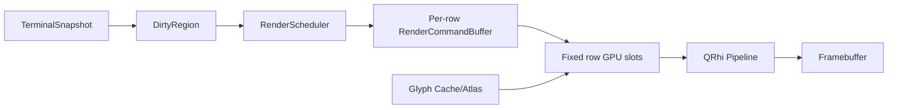
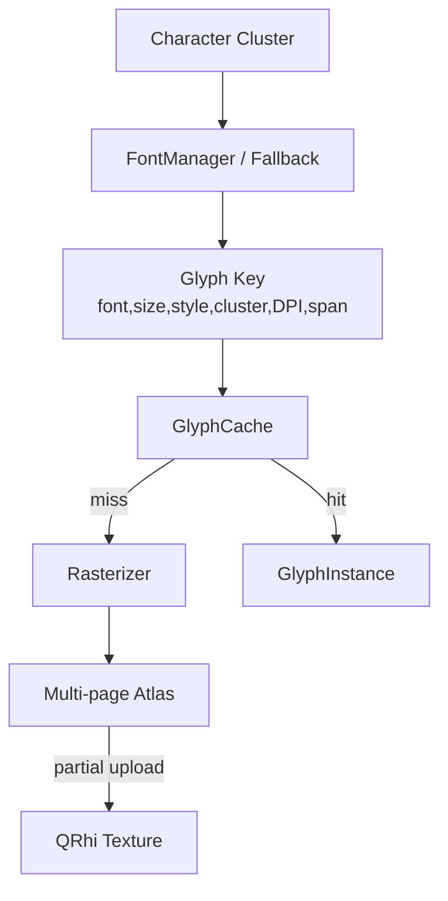

# NovaTerm 渲染架构

## 1. 管线



P3 当前采用固定行槽位实现局部上传：每行独立背景区和内容区，Overlay 独立。提交顺序为“全部背景 → 全部内容 → Overlay”，避免相邻背景覆盖字形抗锯齿边缘。

## 2. RenderScheduler

Scheduler 裁剪并合并相邻/重叠 DirtyRegion；区域超过 32 个或覆盖率达到 60% 时升级全屏；按 60/120/144 Hz 每帧间隔最多提交一次。Cursor 和 Selection 只使 Overlay 失效。

### 2.1 隐藏恢复与设置更新（2026-10-07）

借鉴 Windows Terminal 的停绘恢复与请求合并原则，Renderer 隐藏或最小化时
暂停 Scheduler 和光标计时器。停绘期间只保留全屏恢复标记、overlay 标记与
最新内容版本，不持续唤醒绘制，也不积累离散 damage 列表。恢复显示后同步
视口，基于最新不可变快照全量重建。终端解析与历史维护仍继续进行。

光标恢复原来的 530 ms 周期闪烁：可见时启动计时器，隐藏/最小化时停止。
只有低频 timeout 回调查询光标可见性与闪烁模式；浏览历史时不查询也不请求
光标帧。damage、cursorMoved 和历史维护不额外同步读取光标模式，不重置
闪烁周期。此前增加的连续输出常亮逻辑及其高频查询已撤回。
渲染快照与 overlay 帧本来就需要的核心读取保持不变。

字体先归一化字号再比较，相同有效字体不清空 atlas 或触发重排。配色首次应用
仍同步核心默认色；随后默认前景/背景或 ANSI 调色板变化重建内容，仅光标色或
选区色变化更新 overlay，相同绘制颜色不请求新帧。方案名称变化只更新元数据。

上述调整保留不可变行快照、局部 GPU 上传与多页 LRU，未引入 Windows Terminal
的整屏实例生成或平台专属交换链等待机制。

最终同机 D3D11 大文本三轮结果见
[撤回后验收](Performance_Render_Rollback_2026-10-07.md)：吞吐与帧率中位数恢复至
基线范围，隐藏调度为 0。按用户要求，仅保留最后一次统一计时的验收结果，
其他批次报告与结果已清理。

## 3. Command 模型

后端无关命令包括 BackgroundRect、GlyphInstance、Underline、Strike、Cursor、Selection，以及预留 Hyperlink/Search Overlay。命令只保存逻辑矩形、UV 和颜色，不持有 QRhi 资源。

## 4. Snapshot 与增量更新

每帧只获取一次稳定 Snapshot。普通 damage 只重建相交行；未变化行保留 CPU 命令和 GPU 数据。当前值语义 Snapshot 后续可替换为共享不可变行/Chunk，但 Renderer API 应继续只读。

历史视口折行时取得的逻辑行 pin 直接移交 `RendererSnapshot.historyPins`。
Core 按行 ID 顺序复用这些 pin，为每个显示切片复制 Cell 或计算身份指纹，
避免同一逻辑行在布局后再经 `lineById()` 重读。pin 保持快照所有权，不能借用
缓存或活动尾块的裸引用；Pending 仍不交付部分视口，完成锚点仍绑定实际全量重建。

## 5. Glyph 目标架构



P5 的多页 Atlas、LRU、局部上传、CJK fallback、组合字符、Emoji、DPI/generation 失效与资源恢复已完成 Linux Vulkan/OpenGL 与 Windows D3D11/D3D12 本机验收，以及 Windows 30 分钟长稳验收（2026-08-02）；macOS Metal、真实多屏 DPR 与真实 120/144 Hz 验收待完成。最新状态以 P5 阶段文档为准。

## 6. 退化与恢复

- resize、字体、主题、滚动映射和 GPU 资源恢复触发全屏失效；
- 固定槽位不足时扩容，禁止截断命令；
- Atlas miss 不得显示错误旧字形；
- GPU 资源丢失后所有有效 CPU 命令重新上传；
- 高频输出允许跳过中间画面，但最终帧必须来自最新一致 Snapshot。

## 7. 指标

记录原始/合并 Dirty 数、调度/合并/全屏帧、重建行、命令数、命令生成时间、CPU 帧时间、上传字节、Draw Call 和 Buffer 重分配。GPU 时间应使用后端时间戳或外部工具测量，禁止为统计引入同步等待。

## P0/P1 性能优化实施记录（2026-09-13）

针对 `perf.data`（本地 PTY 持续输出，build-id `2c289bb5…`）暴露的热点，
渲染侧完成了四项收窄，逐项证据见 `AGENTS.md` 的「P0/P1 性能优化实施记录」：

| 项 | 变化 | 基线热点 | 回归用例 |
| --- | --- | --- | --- |
| 行/块指纹合并 | `RendererSnapshot` 一次遍历产出 8 列块指纹与整行 identity；`RowBlockDamageTracker` 只消费快照块指纹 | `rowContentIdentity` 2.86% + `blockIdentity` 3.03% | `rendererSnapshotPublishesBlockIdentities`、`rowBlockDamageFindsOmittedStaleTail` |
| instance 暂存收窄 | `assembleSpanInstances()`：背景逐列直接覆盖、内容只清本次 span、scratch 复用 | `__memmove` 6.18%（81% 来自 uploadCommands）+ `QList<GpuInstance>::fill` 1.84% | 三个 `spanAssembly*` |
| RenderCommand 容量与 merge | `mutableRow()/finishRow()` 就地重建并复用容量；一次按列线性 merge 取代每行两次 `stable_sort` | 排序/扩容合计 4.25% | `incrementalRowMergeKeepsOrderAndColumns` |
| Glyph 稳态收窄 | `makeKeyAndSelection()` 一次选择产出 key+selection；ASCII 直连缓存；emoji 判定去掉 `toUcs4()` 分配 | `ensureGlyph` 子树 5.25% | `asciiSelectionUsesDirectCacheAndSingleQuery` |

约定：`RenderCommandRow` 的 `backgrounds`/`contents` 必须按 `cellColumn` 升序
（`mergeRowCommandsIncremental()` 与 `assembleSpanInstances()` 都依赖这一点）；
`contentUploadBytes` 统计的是基础内容区域（背景 + 内容两层）。


## 渲染审查与局部优化（2026-11-01，0.2.119）

本轮按qt-cpp-review扫描renderer与ui/terminal的31个源码文件，产生102条机械诊断；三位只读审查代理分别覆盖性能/API、所有权/线程、快照契约/错误处理。机械风格不作为优化目标。

已实施：

- RowBlockDamageTracker在原span容器内排序并压缩合并，保留调用方移入的容量，避免每个脏行新建merged容器。新增裁剪、相邻/重叠、空区间和共享输入不被修改的回归。
- 重建与上传脏区改为有边界检查的常量引用，省去QVector::value产生的临时共享副本与引用计数；不宣称这些临时副本本身引起深拷贝。
- 高亮预过滤在未解析尾部出现分支时保守回退，扩展正则语法禁用字面预过滤；补上原“真实命中”测试漏掉的断言。默认规则的过滤行为保留。
- GPU缓冲规划先做宽整数与预算检查，成功前不提交布局；返回nullopt区分失败与无需重分配。失败帧不上传/绘制旧buffer，保留下一次完整重建意图，不主动空转重试。Null后端测试覆盖小缓冲→预算拒绝→恢复。

验证：新增预算/高亮回归真实RED为2pass/2fail；首次GREEN构建因调用处仍声明bool而失败，改为auto后主程序及两个渲染目标构建通过。最终相关CTest2/2（5.34秒：renderer5.05秒、renderer_p5 0.28秒）。QRhi Null验证预算流程，offscreen环境的QRhiWidget不支持提示保留；未作真实GPU截图、实机帧率或其他平台验收。span循环另以ASan/UBSan执行5×500000次无报告，Qt依赖仍为普通构建，不能扩大为完整渲染消毒器验收。两位代理复审span/高亮与GPU预算修复，无新增高可信问题。

局部CPU基准：1行240列、30个identity block，每轮500000次修改一个block并传入[16,24)损伤、移动复用同一span容器，5轮checksum均949999。Release -O3、同机Qt6.8.3：修改前40535/39049/39242/41530/39374微秒，修改后37180/30464/30603/30135/30334微秒；中位39374→30464微秒，降低22.6%。该数字仅代表损伤合并循环，不代表终端整体吞吐或GPU帧率。临时基准源和日志在/tmp/novaterm-span-*，渲染测试在/tmp/novaterm-render-tests.log，不入Git。

审查中另发现的待验证项（尚未实施）：冷历史复制完成回调在clipboard或historyReadMessage同步销毁Renderer后可能访问已销毁对象；DPR切换只按font generation取消任务，旧比例任务可能滞留；Cell italic未传到实际ensureGlyph字体选择。上述为静态调用链证据，需分别建立针对性回归后处理，不以本轮测试声称已修复。


0.2.119独立提交验证：临时移开后续libvterm优化，主程序和两个渲染目标重建成功，CTest2/2（5.44秒）。版本由0.2.118递增，未将后续解析器收益计入本提交。

## perf驱动的高收益调优收口（2026-11-01，0.2.120）

用户进一步要求使用本机性能工具且只优化高收益模块。本轮以已有渲染修改为工作区基线，使用Linux perf 6.8.12、Intel i7-14700K、Qt6.8.3 Release、X11/OpenGL。perf_event_paranoid=-1。没有改系统调度、电源、显示设置，未操作用户运行实例或设备。仅保留新发现的滚动历史导出优化，不继续扩张零散小热点。

首轮perf采样：真实P5 OpenGL基准约60FPS，应用热点分散且含驱动成本；64MiB核心解析负载的P核样本中vterm_screen_get_cell self约32.06%，scrollrect累计约63.47%，因此选择后者。将sb_pushline_from_row逐格调用改为现有vterm_screen_get_cells整行导出，并把批量函数的getcell(row,0)移到循环外；每物理行只解析一次ring offset，属性/颜色/宽字转换不变，resize旧视图路径不动。

三轮交替A/B均为64MiB输入、100000历史行、taskset -c 0-15，未插桩。优化前二进制先保存到/tmp，编译完成后串行运行，不在采样期间构建：

|轮次|修改前 MiB/s|修改后 MiB/s|
|---|---:|---:|
|1|24.27|30.48|
|2|24.24|30.80|
|3|23.66|30.53|
|中位数|24.24|30.53|

吞吐中位数提高25.95%；这些是本机固定合成解析负载的结果，不代表SSH/UART链路速率或整体GPU帧率提升。两版基准均通过自身Parser correctness barrier及P2吞吐门槛。

相同CPU集合、499Hz、cycles:u、DWARF栈复采无丢样：旧逐格导出self37.82%，新批量导出self24.43%，事件周期估计15415100061→12095994852。占比变化不是单独的时间收益证明，吞吐结论以上表未插桩A/B为准。

```sh
perf record -F 199 --call-graph dwarf,8192 -o /tmp/novaterm-render-profile.data -- build/Release/bin/novaterm_renderer_p5_gpu_benchmark --duration-ms 10000
# 上行运行时设置 NOVATERM_RHI_API=opengl QT_QPA_PLATFORM=xcb
# 分别对保存的before/after二进制执行，交替三轮：
taskset -c 0-15 /tmp/novaterm-core-before --bytes 67108864 --lines 100000
taskset -c 0-15 /tmp/novaterm-core-after --bytes 67108864 --lines 100000
# 两版分别采样，文件名按before/after区分：
taskset -c 0-15 perf record -e cycles:u -F 499 --call-graph dwarf,8192 -o /tmp/novaterm-core-after-final.data -- /tmp/novaterm-core-after --bytes 67108864 --lines 100000
perf report --stdio --no-children -g none -i /tmp/novaterm-core-after-final.data
```

验证：新增整行批量/逐格导出等价测试覆盖环形滚动、CJK、组合字符、SGR/颜色、resize、备用屏和全局反色。主程序及相关目标构建通过；Core/terminal_ops/scrollback/renderer/renderer_p5 CTest5/5（13.32秒）。完整libvterm另以ASan/UBSan编译，独立10000次输入/resize/逐格比对夹具经过17298次scrollback回调无报告。只读独立复审未见新增高可信问题；不把完整行等价性扩张到任意切片（原批量接口的宽字末列切片边界未在本轮改变）。

真实GPU验收保留失败与成功：首次未预填历史的采样轮次及固定DPI重试均报steady-scroll requested history reflow，优化前后均出现。检查确认空历史首次建布局会scheduleReflow，与该基准的零稳态重排断言冲突。使用已有--prefill-lines 1000参数预热（不放宽断言、不改产品逻辑）后OpenGL 5秒验收通过，约60.15FPS，published/rendered revision均306，glyph队列归零、converged=true。它是图形正确性/稳态验收，不作GPU前后性能比较。

证据保存在/tmp/novaterm-core-ab-*.log、/tmp/novaterm-core-*-final.data、/tmp/novaterm-profile-final-{build,tests}.log、/tmp/novaterm-vterm-sanitize.log和/tmp/novaterm-render-gpu-warm.log；为本机临时证据，不纳入Git。上一节未修复的其他审查项保持原状态，本轮按用户高收益约束未扩大到这些功能路径。

0.2.120提交前验证：基于已推送的0.2.119恢复本节libvterm优化，主程序及相关目标构建成功，Core/terminal_ops/scrollback/renderer/renderer_p5 CTest5/5（13.22秒）。本提交只纳入本节解析器优化、等价测试和记录，未混入后续搜索修改。


## 0.2.128 通用混排字体基线与墨迹边界修复（2026-11-02）

用户截图中的中英文错位来自回退字体按自身ascent绘制、GPU统一按顶部放置。主字体基线现在以1/1024逻辑单位缓存并进入GlyphKey，异步任务按该基线绘制。位图以tightBoundingRect、网格和advance的并集确定边界，允许负bearing/重音伸出，物理边界向外取整；图像字体DPI与度量DPI一致。现有Cell italic同时透传到FontManager，粗斜体不再被固定false抹掉。网格列宽/行高、atlas预算及256KiB单字形上限保留，非有限/超大几何在整数转换前拒绝。度量在字形miss的worker处理，主基线只在字体变化时更新。

不是本机固定偏移：测试使用系统FixedFont/GeneralFont，涵盖回退字体高/低两方向、普通/粗体、实际Cell斜体、点/像素字号、组合字符及已给定Emoji cluster。独立大画布比较可见墨迹不丢失；使用相同局部绘制坐标保持bitmap字体hinting相位一致。原像素参考初版8个Emoji失败经alpha边界分析为整体1像素偏移而非裁剪，修正参考坐标后仍保留严格墨迹断言。

原始RED分别保留：基线2pass/4fail、实际Renderer请求2pass/1fail；扩展墨迹4pass/58fail、斜体透传2pass/1fail。最终0.2.128主程序及渲染目标构建成功，CTest2/2（5.79秒），QTest分别74/74和167/167。五组实际字体DPI72/96/120/144/192分别140/140；位图DPR1/1.25/1.5/1.75/2/3。初轮仅设置QT_FONT_DPI时120以上被Qt归一化为96，未当作五组实际覆盖；最终仅测试进程关闭自动换算并由探针确认实际DPI后完成矩阵。生产缩放设置未改变。

GlyphRasterizer局部ASan/UBSan/float-cast-overflow插桩，其他库Release，最终P5 167/167（636ms），无报告。Linux OpenGL与Vulkan的预填历史GPU场景均acceptance=pass；最终OpenGL实测截图含混排、粗/斜体和组合字符。约1.823倍DPR下原始主/回退字体ascent差4.17逻辑像素，仅是复现数据，不进入补偿常量。最初native/aligned截图使用独立夹具切换基线，最终图为完整修复代码；未操作用户正在运行的会话。

Windows/macOS原生后端与真实跨屏移动未实机验证，不冒充多平台验收；Emoji测试不表示Core已支持所有跨Cell grapheme聚类。临时日志/tmp/novaterm-font-*.log、/tmp/novaterm-glyph-final-sanitized.log、截图/tmp/novaterm-font-final.png不纳入Git。通用规则同步至[字体修复指南](../NovaTerm_TerminalRenderer_字符间距异常修复指南.md)。
